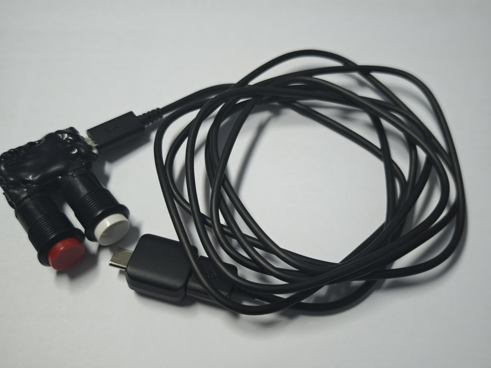
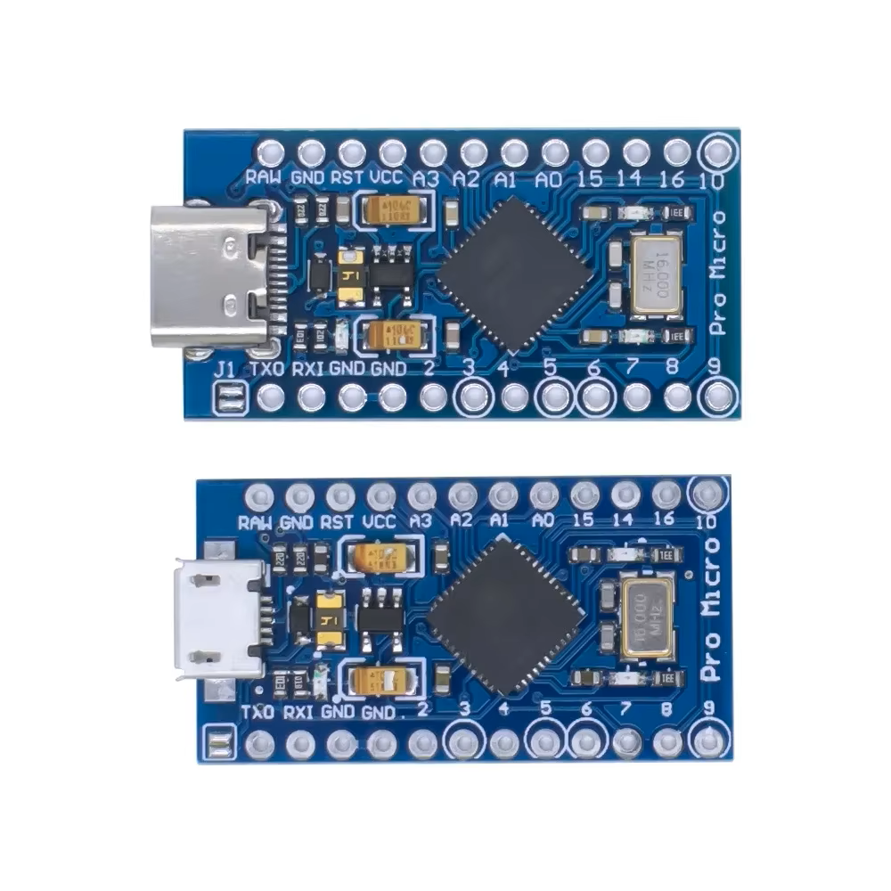

# HandyTranslator · Google 두 버튼 음성 번역기

**Google Cloud Translation을 프로젝트의 번역 서비스로 확정한다.** 현재 버전은 Google v0.3이다.

[GitHub 저장소](https://github.com/realmadkid/handytranslator) · [라이선스](LICENSE)

한국어와 일본어를 두 개의 USB 물리 버튼으로 번역한다. 버튼을 누르고 준비 진동 후 말한 다음 놓으면, 반대 언어로 번역해 읽는다. 활성 세션에서는 화면을 완전히 끄고 사용할 수 있다.

## 프로토타입



보드에 버튼 두개를 납땜하고 글루건으로 고정한 프로토타입. 빨간색·흰색 물리 버튼 두 개와 스마트폰 연결용 USB 케이블로 구성되어 있다.

## 시작하기

1. Google v0.3 APK 설치. 로컬 빌드 결과는 `deliverables/HandyTranslator-Google-v0.3.apk`에 생성된다.
2. [Google Cloud 설정 안내](docs/GOOGLE-SETUP.md)에 따라 프로젝트·API 키·할당량 설정.
3. 앱의 **설정**에서 API 키 입력, 폰에 한국어·일본어 오프라인 TTS 음성 설치.
4. **시작**을 누르고 마이크 권한 허용. 보드를 연결해 두 버튼 사용.
5. 최초 USB 연결 시 이 앱을 기본으로 선택하면 이후 잠금 해제 상태에서 세션 자동 시작.
6. 사용 후 **종료** 또는 알림의 종료 버튼으로 세션 종료.

## 구성

물리 버튼 → Pro Micro USB MIDI → Android 음성인식 → Google Cloud Translation Basic v2 NMT → Android 오프라인 TTS.

- Android 9(API 28)+ 대상. USB host/OTG와 MIDI 지원 필요.
- 기본 화면: 상태, 시작/종료, 두 방향 버튼, 최근 번역문, 설정.
- 화면 크기와 글꼴에 대응하는 가변 높이·스크롤, 넓은 화면의 중앙 배치.
- API 키는 폰에서 직접 입력하고 Android Keystore로 암호화 저장. 소스/APK에 키를 넣지 않는다.
- 무료 사용을 위한 앱 요청량 제한: 일 14,000 / 월 450,000 문자. Cloud 콘솔 할당량도 별도로 설정한다. 앱의 추정치가 계정 전체 과금을 보장하지는 않는다.

## 보드와 배선



ATmega32U4 Pro Micro 5V/16MHz, Leonardo 부트로더. USB 데이터 케이블/OTG 어댑터 사용.

| 기능 | 핀 | 반대쪽 |
|---|---|---|
| 한국어 → 일본어 | D4 | GND |
| 일본어 → 한국어 | D5 | GND |

두 버튼 모두 평소 열려 있는 NO 모멘터리이며 INPUT_PULLUP을 사용한다. 현재 펌웨어는 앱 v0.3에서도 그대로 사용한다.

## 파일

- `google-app/`: Android 앱 소스와 빌드 스크립트.
- `firmware/HandyTranslator/`: 두 버튼 펌웨어 소스.
- `docs/`: 설정·설계·검증·빌드 안내 및 프로토타입 사진.
- `scripts/`: 공개용 소스 ZIP 생성 도구.
- `deliverables/`: 로컬 APK·소스 ZIP·해시·펌웨어 출력. Git에서는 제외하며 GitHub Releases 배포에 사용.
- `tools/`, `google-app/build/`: 로컬 도구·빌드 캐시·서명 키. Git과 소스 ZIP에서 제외.
- [설계 및 범위](docs/PROJECT.md), [설정 안내](docs/GOOGLE-SETUP.md), [검증 기록](docs/GOOGLE-TEST.md).

## 빌드

```powershell
powershell -NoProfile -ExecutionPolicy Bypass -File google-app\build.ps1
powershell -NoProfile -ExecutionPolicy Bypass -File build-firmware.ps1
```

앱: JDK 17, Android SDK platform 35/build-tools 35.0.1.  
펌웨어: 로컬 Arduino CLI, AVR Leonardo 및 MIDIUSB.  
업데이트 서명을 유지하려면 `google-app/build/prototype.keystore`를 보존한다. 키는 배포 ZIP에 넣지 않는다.

자세한 환경 준비 및 배포 절차는 [빌드·배포 안내](docs/BUILD.md)를 확인한다.

## 검증 범위

사용자 폰에서 화면 꺼짐 양방향 번역, 10분 이상 대기 후 입력, 보드 연결 자동 시작을 확인했다.  
v0.3 UI는 작은 화면·가로·200% 글꼴·넓은 화면의 레이아웃 접근성을 검사했다.  
모든 기종/해상도 또는 Android 9 실기까지 검증한 것은 아니다.

세션은 최대 2시간, 입력은 최대 45초다. 
음성인식의 침묵 종료 후 재시작 사이 짧은 누락이 있을 수 있다. 잠긴 상태의 최초 연결은 잠금 해제가 필요할 수 있다.  
음성은 기본 인식 제공자에게, 인식된 문장은 Google Cloud에 전송될 수 있다. 앱은 대화를 파일로 저장하지 않는다.
